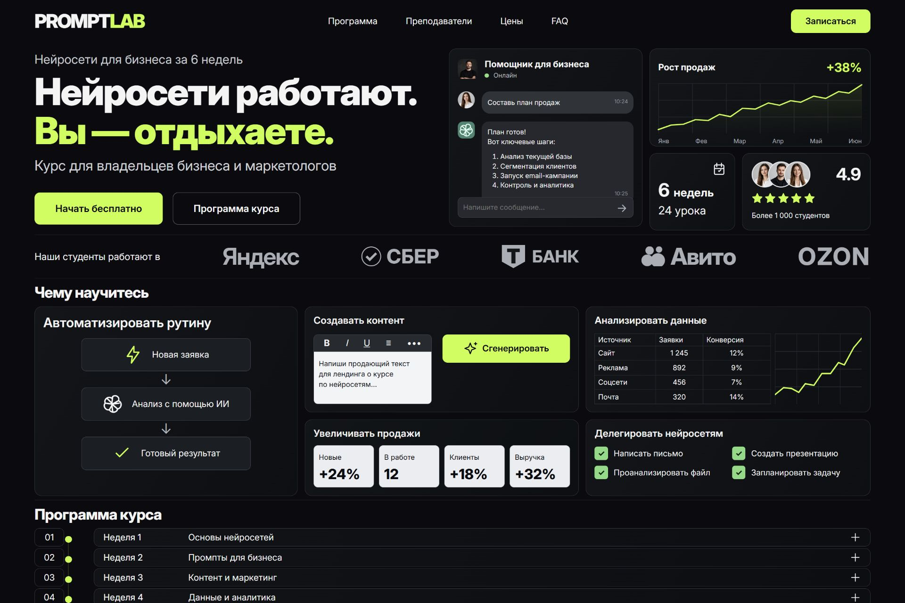
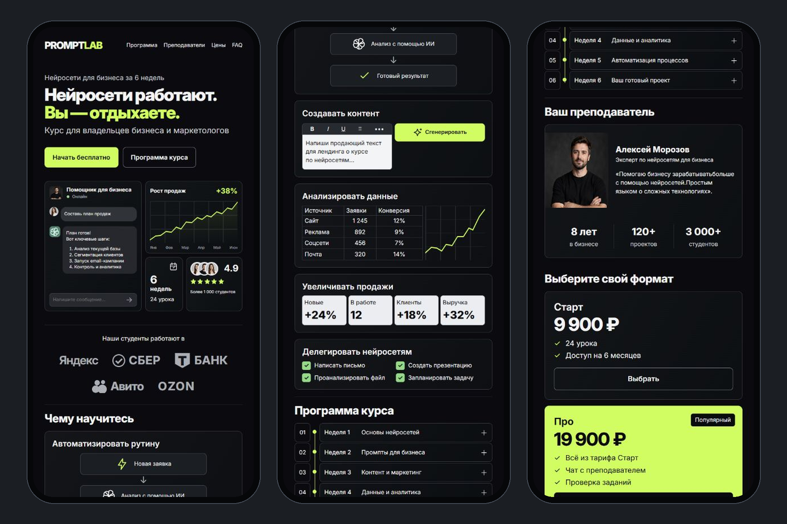

# PROMPTLAB — лендинг онлайн-курса

Адаптивный демонстрационный лендинг «Нейросети для бизнеса за 6 недель». Тёмная тема, лаймовые акценты, бенто-сетка и интерфейс на русском языке.



## Возможности

- Переходы к программе, преподавателю, тарифам, FAQ и форме.
- Раскрывающиеся шесть недель программы и пять вопросов FAQ.
- Выбор тарифа, проверка имени и телефона, сохранение заявки в браузере.
- Интерактивные демонстрации чата и редактора текста.
- Адаптивная мобильная вёрстка, управление с клавиатуры, поддержка уменьшения анимации.

## Запуск

Требуется Node.js. Установка зависимостей не нужна.

```sh
node server.cjs
```

Откройте http://127.0.0.1:4173/. В Windows можно запустить файл `Запустить сайт.cmd`. Для просмотра также можно открыть `index.html`; доступ к хранилищу браузера для локальных файлов зависит от его настроек.

## Скриншоты для портфолио

Все пять изображений имеют размер **1920 × 1280**. Они подготовлены из настоящих скриншотов работающего сайта; десктопные изображения вместе покрывают всю страницу, мобильные листы показывают последовательные экраны.

| Файл | Содержание |
| --- | --- |
| [01_hero.png](screens/01_hero.png) | Первый экран и блок навыков; обложка работы |
| [02_program_teacher_prices.png](screens/02_program_teacher_prices.png) | Программа, преподаватель и тарифы |
| [03_reviews_faq_footer.png](screens/03_reviews_faq_footer.png) | Тарифы, отзывы, FAQ, форма и подвал |
| [04_mobile_top.png](screens/04_mobile_top.png) | Три мобильных экрана: начало страницы |
| [05_mobile_bottom.png](screens/05_mobile_bottom.png) | Три мобильных экрана: продолжение до подвала |



## Структура

`index.html` — разметка, `styles.css` — оформление и адаптация, `app.js` — поведение интерфейса, `server.cjs` — локальный сервер. В `assets/` находятся портреты, значок сайта, веб-шрифт Inter и его лицензия; в `screens/` — готовые изображения портфолио.

## Статус проекта

Это учебный проект для портфолио. Имена, отзывы, показатели и названия компаний — демонстрационное содержание макета, а не подтверждение заказчиков или партнёрств. Портреты сгенерированы. Заявка сохраняется только на устройстве посетителя; отправка на сервер, CRM, оплата и реальная нейросеть не подключены.

Шрифт Inter поставляется с лицензией [SIL Open Font License](assets/Inter-LICENSE.txt).
